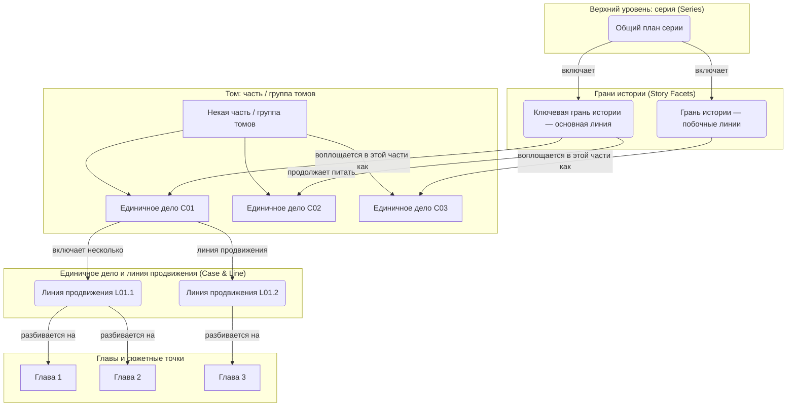

# Общие судейские правила планов и единая система нумерации

## Цели и позиционирование (исполнительный документ для автора)

Вы создаёте или поддерживаете «исполнительную версию плана, по которой автор пишет основной текст». Её главная ценность — не литературный блеск для читателя, а:

- **Исполнимость**: с ним в руках автор может прямо разбивать на главы, писать сцены, диалоги, продвигать улики и цену
- **Аудируемость**: можно взаимно сверять с биографиями персонажей, временной осью, реестром улик, реестром пула подозреваемых
- **Взаимосвязанность**: общий план, части, тома, списки глав и реестры могут ссылаться друг на друга, а не писаться каждый сам по себе
- **Ремонтопригодность**: при последующих инкрементных корректировках в ходе публикации всё не выходит из-под контроля

## Принцип сохранения информации (обязательно)

- Информация, общая для всех уровней, включает, но не ограничивается: принципы исполнения для автора, правила записи файлов, исследование и глубокое осмысление, единую систему нумерации, согласованность персонажей, жёсткие стандарты цепочки улик, взаимосвязь с реестрами, правила заголовков, контроль качества, особые требования и указания
- Нельзя терять ни одного существующего требования из-за разбиения
- При конфликте файлов разных уровней порядок приоритета по умолчанию:
  1. Явное требование пользователя в текущем раунде
  2. Файл-арбитр проекта
  3. Действующие общие жёсткие ограничения
  4. Специальные исполнительные правила уровня

## История — не тематический лозунг

### Критерии отличия истории от темы

**Неверное написание**: только суждение о теме, без конкретных событий, людей, времени, места, мотивов и процесса.

**Верное написание**: одновременно должны присутствовать:

- **WHO (персонажи)**: конкретные роли, личности, позиции, отношения
- **WHAT (события)**: что произошло, как продвигается конфликт
- **WHEN (время)**: когда произошло, как долго длилось, где ключевые узлы
- **WHERE (место)**: где произошло, как пространство влияет на конфликт
- **WHY (мотив)**: почему персонаж так поступает
- **HOW (процесс)**: как событие происходило шаг за шагом

### Стандарты конкретизации граней истории и сюжетных линий

**Грань истории**: должна быть полным сюжетным развитием через этапы / группы томов с чёткой основной линией персонажей, последовательностью событий, временной линией, сценическими настройками, мотивацией и описанием процесса.

**Сюжетная линия**: должна быть конкретной цепочкой сюжета внутри одного этапа, содержащей конкретные сцены и события, чёткие действия персонажей, ясные причинно-следственные связи, ощутимые конфликты и повороты.

## Глобальная единая система нумерации (ID System)

Чтобы в огромной архитектуре истории обеспечить точные перекрёстные ссылки и прослеживаемость, для всех граней истории, сюжетных блоков, сюжетных линий, улик, подозреваемых и завязок следует использовать единую нумерацию.

### 1. ID грани истории (Facet ID)

- **Грань загадки основной линии**: `M0` (единственная на всю книгу)
- **Важные грани побочных линий**: `X01`, `X02`……

### 2. ID сюжетного блока (Plot Block ID)

- **Формат**: `C[номер]`
- **Пример**: `C01`, `C02`
- **Пометка межтомная / межэтапная (необязательно)**: `C03@V2`

### 3. ID сюжетной линии (Storyline ID)

- **Формат**: `L[номер дела].[номер]`
- **Пример**: `L01.1`, `L01.2`

### Сопутствующие ID (настоятельно рекомендуется)

- **ID улики**: `CL[номер дела].[номер]`
- **ID подозреваемого**: `SUS[номер дела].[номер]`
- **ID завязки / развязки**: `FB[номер]`

### Основные правила использования

- **Уникальность**: каждый ID должен быть уникален во всём проекте
- **Ясная иерархия**: по ID можно быстро определить уровень повествовательной единицы и отношение к родительскому уровню
- **Обязательное использование**: использовать эту систему в заголовках и перекрёстных ссылках файлов планов на стороне автора
- **Изоляция от читателя**: эти ID служат только для внутреннего планирования автора, перекрёстных ссылок, ведения реестров и аудита рецензирования; если только сам номер не является естественным для мира номером дела / документа и не имеет сюжетных оснований, их нельзя напрямую вписывать в основной текст, производные тексты для разных платформ, эпиграфы глав или `作者有话说 (слово автора)`

## Трёхуровневая архитектура плана (объём → грань → линия → точка)

Рекомендуется разбирать длинный роман по следующей логике:

Вся книга (длинный роман в целом) → грань загадки основной линии (M0) → единичное дело / сюжетный блок (Cxx) → линия продвижения (Lxx) → сюжетная точка главы (Scene / Chapter)

## Технические нормы и контроль качества

### Строгие требования к иерархической архитектуре плана (единый стандарт гранулярности)

- **Общий план**: уровень стратегической грани истории, существует через этапы / через тома
- **План части**: уровень сюжетной линии кампании, существует через тома
- **План тома**: уровень исполнимых сюжетных точек, существует внутри глав

### Единые нормы именования файлов

- Общий план: `总大纲.md`
- План части: `X.《部标题》- 详细大纲.md`
- План тома: `X.Y.《卷标题》- 分卷大纲.md`
- Файл главы: `X.《章节标题》.md`

### Минимальные стандарты качества содержания

- Все элементы истории должны быть конкретизированы, абсолютно не допускается концептуальное описание
- Каждая история должна содержать полные шесть элементов (WHO / WHAT / WHEN / WHERE / WHY / HOW)
- Действия персонажей должны иметь чёткий мотив и логическую цепочку
- Профессиональные процедуры, цепочка улик, ограничения правил должны быть самосогласованными и прослеживаемыми, избегая «переворота ради переворота»

### Проверка межуровневой согласованности

- Нижестоящие планы обязаны полностью подхватывать вышестоящие, без пропусков и искажений
- Биографии персонажей и описания в плане должны полностью совпадать, не должно быть противоречий в образах
- Временная линия, места, развитие технологий должны быть согласованы от начала до конца
- Выражение тематической идеи должно сохранять связность на всех уровнях

## Абсолютно запрещённые отписки

- Абстрактные понятия вместо истории
- Отсутствие элементов истории
- Ключевой сюжет, пересказанный одной фразой
- Заполнение пустыми понятиями
- Безымянные персонажи, расплывчатые события, размытые время и пространство
- Путаница уровней, несоответствие объёмов, логические разрывы
- Смешивание стадий развития нескольких граней истории в одну отписочную фразу
- Описание только функции завязки без описания конкретного процесса закладки и раскрытия

## Критерии успеха

- Строгая логика, полнокровные персонажи, ясные тема и основная линия
- Каждая «грань истории» и «сюжетная линия» — настоящая история, а не абстрактное понятие
- Каждый ключевой артефакт плана можно отослать назад к соответствующему персонажу, реестру, временной линии и нижестоящему исполнительному файлу

## Шаблон диагностики проблем

### Проверка конкретизации истории

- Содержат ли все грани истории конкретных персонажей, события, время, место, мотив, процесс?
- Нет ли случаев, когда конкретная история заменена тематическим понятием?
- Есть ли у персонажей конкретные имена, личности и действия?
- Есть ли у событий чёткие причина, процесс, результат?
- Точны ли время и место до уровня исполнимости?

### Проверка гранулярности

- Нет ли проблемы «сюжета в одну фразу»?
- Соответствует ли глубина каждого уровня его позиционированию?
- Способно ли содержание выдержать реальный объём написания?

### Проверка логики

- Ясны ли связи преемственности между уровнями?
- Нет ли логических скачков или разрывов?
- Полно ли отображение системы нумерации на реестры?
- Разумно ли расставлены завязки и можно ли их развязать?

### Проверка качества

- Объёмна ли проработка персонажей?
- Передаётся ли выражение темы естественно через цепочку событий?
- Достаточно ли реалистической заботы и профессиональных деталей?

## Быстрый процесс исправления

1. **Выявление проблемы**: сначала определить основной тип проблемы (конкретизация / гранулярность / логика / качество)
2. **Исправление конкретизации истории**: заменить абстрактные понятия конкретными историями с шестью элементами
3. **Корректировка уровня**: обеспечить соответствие гранулярности содержания уровню
4. **Восполнение объёма**: дополнить до минимальной исполнимой глубины по требованиям уровня
5. **Прояснение логики**: исправить связи преемственности между уровнями и отображение на реестры
6. **Повышение качества**: усилить цепочки событий, персонажей, цены и награды
7. **Перекрёстная проверка**: сверить с персонажами, реестрами, временной осью и вышестоящими / нижестоящими файлами
